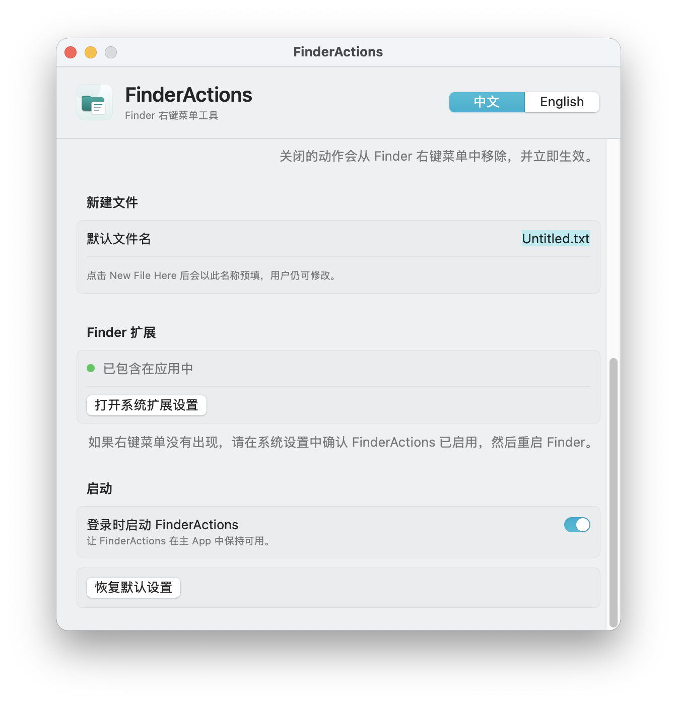

# FinderActions

<p align="center">
  
</p>

<p align="center">
  A lightweight macOS Finder context-menu utility for creating files, opening Terminal, copying paths, and copying names.
</p>

**English** · [简体中文](README.zh-CN.md)



## Features

- **New File Here…**
  - Create an empty file in the current Finder folder.
  - Uses a file-name prompt with the configured default name.
- **Open Terminal Here**
  - Open the current folder in Apple Terminal.
- **Copy Path Here**
  - Copy the selected items' full POSIX paths.
- **Copy Name Here**
  - Copy the selected items' names.
- **Grouped or flat menu**
  - Group actions under `FinderActions ▸`, or show them directly in Finder's context menu.
- **Chinese / English interface**
  - Defaults to Chinese.
- **Launch at login**
  - Optional login-item support using `SMAppService`.
- **No network access**
  - No telemetry, analytics, sync, or update checks.

## Requirements

- macOS 13 or later
- Finder Sync extension enabled in System Settings

## Download

Get the latest build from [Releases](https://github.com/21duxue/FinderActions/releases/latest).

- **Recommended:** `FinderActions-v0.1.0-macOS.dmg`
- **Alternative:** `FinderActions-v0.1.0-macOS.zip`
- **Checksums:** `SHA256SUMS.txt`

## Install

### DMG

1. Open `FinderActions-v0.1.0-macOS.dmg`.
2. Drag `FinderActions.app` to `Applications`.
3. Open FinderActions.

### ZIP

1. Unzip `FinderActions-v0.1.0-macOS.zip`.
2. Move `FinderActions.app` to `/Applications`.
3. Open FinderActions.

### Enable the Finder extension

1. Open:

```text
System Settings
→ General
→ Login Items & Extensions
→ Finder Extensions
```

2. Enable **FinderActions**.
3. If the context menu does not appear, restart Finder:

```bash
killall Finder
```

## First launch

This release is ad-hoc signed and is not Apple-notarized. macOS may block the first launch.

If macOS blocks the app:

1. Open **System Settings → Privacy & Security**.
2. Find the FinderActions warning.
3. Click **Open Anyway**.
4. Confirm the launch.

You can also right-click `FinderActions.app` in Finder and choose **Open**.

## Usage

In Finder, right-click:

- an empty area in a folder
- a selected file
- a selected folder

Depending on the selected display mode, you will see either:

```text
FinderActions ▸
  New File Here…
  Open Terminal Here
  Copy Path
  Copy Name
```

or:

```text
New File Here…
Open Terminal Here
Copy Path
Copy Name
```

Actions disabled in Settings are removed from the Finder menu immediately.

## Settings

FinderActions includes:

- Chinese / English language switch
- Grouped / flat Finder menu
- Per-action enable switches
- Default file name
- Finder extension status and settings shortcut
- Launch at login
- Reset to defaults

## Build from source

```bash
swift build
swift run FinderActionsSmokeTests
./Scripts/build-app.sh release
```

The app bundle is created at:

```text
build/FinderActions.app
```

## Testing

Standard Swift Testing suites live in `Tests/FinderActionsCoreTests/`.

This machine currently has only Command Line Tools, not a full Xcode installation, so `swift test` cannot load the Swift Testing macro plugin. A runnable smoke-test executable is included:

```bash
swift run FinderActionsSmokeTests
```

See [docs/TESTING.md](docs/TESTING.md) for details.

## Project structure

```text
Sources/
  FinderActions/            AppKit shell, SwiftUI settings, action coordinator
  FinderActionsCore/        Menu, settings, path, file, and URL logic
  FinderActionsExtension/   Finder Sync extension
  FinderActionsSmokeTests/  Runnable core tests
Tests/
  FinderActionsCoreTests/   Swift Testing suites
Scripts/
  build-app.sh              Builds and signs the app bundle
  make-icon.swift           Regenerates the app icon
  package-release.sh        Creates DMG/ZIP release artifacts
prototype/
  index.html                Interactive design prototype
```

## Known limitations

- Finder Sync menus are not available inside File Provider directories such as iCloud Drive, OneDrive, Dropbox, and Google Drive.
- External drives and SMB shares are outside the v1 support scope.
- The current release is ad-hoc signed, not notarized.
- `swift test` requires a full Xcode installation.

## Privacy

FinderActions performs all work locally:

- no network requests
- no telemetry
- no accounts
- no cloud sync
- no automatic update checks

## License

MIT. See [LICENSE](LICENSE).
